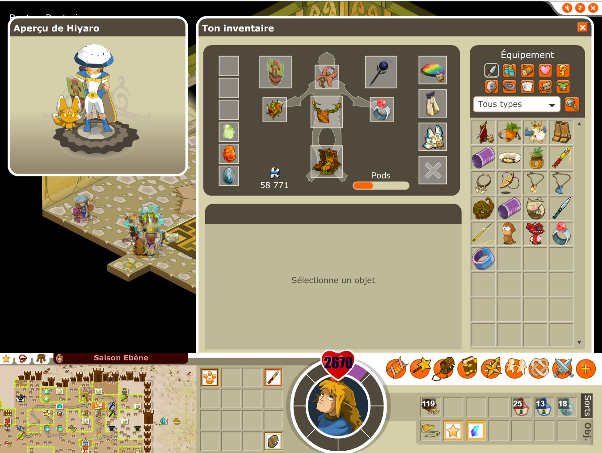
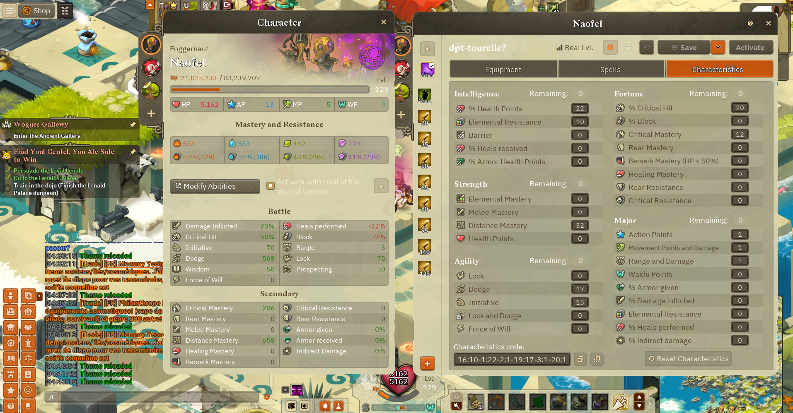

# 🟫 [Retro] — un thème Wakfu aux couleurs de Dofus Retro

> L'âme de **Dofus Retro**, la modernité de **Wakfu**.

**[Retro]** est un thème d'interface pour **WAKFU** qui fusionne deux univers :
la palette chaleureuse et la lisibilité de Dofus Retro (parchemin, bruns, orange vif),
et la finition moderne de Wakfu (relief, ornements, textures, pictos détaillés).

Ce n'est **pas une copie** de Dofus Retro : les formes, la disposition et les polices de
Wakfu sont conservées. Seules les **couleurs** et les **images** de l'interface changent,
comme le permet le système de thèmes officiel d'Ankama.

<p align="center">
  
  <br>
  <em>La référence : l'interface de Dofus Retro (inventaire). Parchemin, panneaux bruns, orange vif.</em>
</p>

<p align="center">
  
  <br>
  <em>État d'avancement : fiche personnage, aptitudes, HUD et chat avec le thème [Retro] (en cours de développement).</em>
</p>

<!-- Image à venir : la fenêtre des aptitudes avec le thème [Retro]
<p align="center">
  
  <br>
  <em>Le résultat dans Wakfu : la fenêtre des aptitudes.</em>
</p>
-->

---

## ✨ Ce que le thème change

| Élément | Dans [Retro] |
|---|---|
| 💬 **Chat** | Fond parchemin clair, couleurs des canaux inspirées de Retro (version pastel) |
| 🗨️ **Bulles de dialogue** | Texte foncé, contour aux couleurs du canal (privé, guilde…) |
| 🎯 **Sélection** | Contours orange façon Retro |
| 🔘 **Boutons principaux** | Orange Retro |
| 📊 **Jauges Wakfu / Stasis / XP** | Couleurs d'origine conservées |
| 🪟 **Fenêtres récentes** (inventaire, fiche, aptitudes…) | Parchemin beige clair, en-têtes brun foncé |
| 🏛️ **Anciennes interfaces** (guilde, métiers, boutique, politique…) | Fond beige clair, zones intérieures beige plus sombre, socles orange au survol et à la sélection |
| 💭 **Dialogues avec les PNJ** | Panneau noir chaud, réponses brunes (orange au survol), bandeau du nom orange brûlé |
| ℹ️ **Infobulles** | Fond brun foncé, texte blanc |
| 🖼️ **Qualité des images** | Toutes les images sont lisses : dessin d'origine conservé, seules les couleurs changent |

---

## 💬 Les couleurs du chat

Wakfu dessine un **contour sombre** autour des lettres du chat. Ce n'est pas un hasard : le
chat peut devenir transparent, et le texte doit rester lisible sur n'importe quelle partie
de la carte. Les couleurs de Retro ont donc été **éclaircies** là où c'était nécessaire, pour
ressortir avec ce contour aussi bien sur le fond parchemin que sur la carte. Certaines
(informations, erreurs, Discussion Ankama) gardent leur couleur Retro d'origine.

Ces couleurs servent aussi au **contour des bulles de dialogue**.

| Canal | Identifiant | Couleur | Inspiration Retro |
|---|---|---|---|
| Général (proximité) | `vicinityChannelColor` | `#d6d6d6` gris clair | le texte général |
| Privé | `privateChannelColor` | `#0066ff` bleu vif | bleu vif |
| Groupe | `partyChannelColor` | `#53c6ff` bleu ciel | bleu du groupe |
| Guilde | `guildChannelColor` | `#a655f8` violet | violet |
| Commerce | `tradeChannelColor` | `#e06e10` orange brûlé | brun du commerce |
| Communauté | `frCommunityChannelColor`… | une couleur par langue (voir plus bas) | — |
| Recrutement | `frRecruitmentChannelColor`… | la couleur de la langue, en plus pâle | gris |
| Politique / nation | `politicChannelColor` | `#ffc400` jaune d'or | orange de l'alignement |
| Zone PvP | `battlegroundChannelColor` | `#ff3c00` rouge-orangé | orange de l'alignement |
| Discussion Ankama | `intergameChannelColor` | `#a3005a` framboise | framboise des « rencontres » |
| Informations | `informationChannelColor` | `#009900` vert Retro | vert |
| Combat | `fightInformationChannelColor` | `#009900` vert Retro | vert |
| Erreurs | `errorChannelColor` | `#bd0000` rouge Retro | rouge des alertes |

**Une couleur par communauté.** Les canaux *Communauté* et *Recrutement* existent dans
chaque langue. Chaque langue a sa propre teinte : franche pour la Communauté, et la même
en plus pâle pour le Recrutement. On reconnaît ainsi la langue d'un message d'un coup d'œil.

| Langue | Teinte | Communauté | Recrutement |
|---|---|---|---|
| 🇫🇷 FR | bleu | `#679bfd` bleu clair | `#bacff8` bleu pâle |
| 🇬🇧 EN | violet | `#936ef8` violet-bleu | `#c8b5fc` lavande pâle |
| 🇪🇸 ES | rouge | `#fc7e7e` corail | `#ffc0c0` rose pâle |
| 🇵🇹 PT | vert | `#d0ff78` vert-jaune | `#e9ffbf` vert pâle |

---

## 🛠️ Comment le thème est fabriqué

### Les images : recolorées sans perte de qualité

L'interface de Wakfu compte plus de 600 images. Elles ne sont pas redessinées à la main :
elles sont **recolorées par des scripts Python** (dossier [`outils/`](outils/)).

Le principe :
- **le dessin vient toujours d'une image lisse** : les originaux du jeu, ou le thème EvaUnit-01
  pour les grandes planches des anciennes interfaces ;
- **seules les couleurs changent** : relief, ombres, dégradés, grain et bords doux sont conservés ;
- **la taille et la transparence ne sont jamais modifiées**, et les images sont enregistrées en PNG, sans perte ;
- certaines images restent d'origine : Dofus, raretés, jauges, couleurs alliés/ennemis, illustrations, pictos.

Chaque retouche est d'abord **diagnostiquée en jeu** : l'image est remplie d'une couleur vive
(ou découpée en cases de couleurs uniques) pour savoir exactement quel écran elle dessine.
Le détail est dans [`docs/INTERFACES.md`](docs/INTERFACES.md).

```bash
pip install pillow numpy scipy
# dessin de l'image lisse + couleurs de l'image recolorée, même taille
python outils/transfert_qualite.py  image_lisse.png  image_recoloree.png  sortie.png
```

### Les couleurs de texte : `colors.xml`

Les couleurs de texte, des listes et du chat se règlent dans `theme/colors/colors.xml`.
Un **thème de diagnostic** (une couleur vive différente par identifiant) a permis de
vérifier en jeu à quoi sert chaque couleur importante :

| Identifiant | Utilisation vérifiée en jeu |
|---|---|
| `mainTextLightColor` | Texte principal : fenêtres, titres des en-têtes, infobulles d'objets, quantités |
| `secondTextLightColor` | Titres de section (« Combat », « Jouabilité »), texte secondaire |
| `mainTextTitleColor` | Texte du champ du chat, cases cochées, onglets inactifs, champs de saisie, kamas |
| `defaultLightColor` | Infobulles d'aide, PV dans le cœur |
| `defaultDarkColor` | Texte des bulles de dialogue |
| `mainTextDarkColor` | Étiquettes claires (rareté, « Actif ») |
| `defaultLightGoldColor` | Jets améliorés dans les infobulles |
| `...ChannelColor` | Texte du chat **et** contour des bulles (voir plus haut) |

> 💡 **Bon à savoir pour les créateurs de thèmes.** Les couleurs des canaux du chat ne sont pas
> présentes dans le `colors.xml` par défaut, mais **le jeu les accepte si on les ajoute**.
> Liste complète des identifiants reconnus par le client :
>
> `vicinityChannelColor` · `privateChannelColor` · `partyChannelColor` · `guildChannelColor` ·
> `tradeChannelColor` · `politicChannelColor` · `battlegroundChannelColor` · `intergameChannelColor` ·
> `informationChannelColor` · `fightInformationChannelColor` · `errorChannelColor` ·
> `frCommunityChannelColor` · `enCommunityChannelColor` · `esCommunityChannelColor` · `ptCommunityChannelColor` ·
> `frRecruitmentChannelColor` · `enRecruitmentChannelColor` · `esRecruitmentChannelColor` · `ptRecruitmentChannelColor`

---

## 📦 Installation

0. Téléchargez la dernière version dans la page **[Releases](../../releases)** : le zip ne contient que le dossier du thème.
1. En jeu : **Options → Interface → Ouvrir le dossier** des thèmes
   (ou, depuis le launcher : *Paramètres du jeu → Répertoire du jeu → Ouvrir le dossier des logs → `themes`*).
2. Copiez le dossier **`theme_Retro-Wakfu`** dans ce dossier `themes`.
3. En jeu : **Actualiser la liste**, choisissez **[Retro]**, puis **Recharger le thème**.
4. Si certaines images ne se mettent pas à jour, **relancez complètement le jeu**.

```
themes/
└── theme_Retro-Wakfu/
    ├── theme.xml
    └── theme/
        ├── colors/colors.xml
        └── images/
            └── textures/ …
```

---

## 🗺️ Avancement

Le thème avance **écran par écran**, une étape testée en jeu à la fois.

- [x] Chat : fond parchemin, champ de saisie, couleurs des canaux, roue des réglages
- [x] Bulles de dialogue
- [x] Fiche personnage : fond parchemin, lignes de stats, couleurs des valeurs
- [x] En-têtes de fenêtres brun foncé, onglets brun / orange
- [x] XP : chiffre et picto orange, barre orange (embout turquoise, partagée avec la jauge Wakfu)
- [x] HUD : panneaux beige clair, boutons orange à pictos blancs
- [x] Groupe et timeline de combat : survol orange
- [x] Boutons : passage progressif en orange
- [x] Écran de connexion : panneau des personnages beige
- [x] Dialogues avec les PNJ
- [x] Qualité : toutes les images refaites à partir de sources lisses
- [x] Anciennes interfaces : fond des fenêtres, fonds intérieurs, socles des menus
- [ ] Anciennes interfaces : boutons, cases de la boutique, bandeaux, infobulles jaunes
- [ ] Guide
- [ ] Passeport
- [ ] Entrée des donjons
- [ ] Champs de saisie et valeurs des aptitudes
- [ ] Suivi de quête

---

## 🙏 Crédits

- **[Ankama](https://www.ankama.com)** : WAKFU, Dofus Retro, et le **modèle de thème officiel** qui sert de base au projet. Toutes les images d'origine leur appartiennent.
- **Nightflow**, par **Ymoka et l'équipe WAKFU** : le `colors.xml` de ce thème a servi de point de départ au projet, et son design des anciennes interfaces est conservé.
- **EvaUnit-01**, par **Dranathilus et l'équipe WAKFU** : ses planches lisses servent de base au dessin des anciennes interfaces.
- **Ailten et KockaColHa** : leur thème Dofus Retro pour Wakfu (2022) a servi de référence et d'inspiration.
- **Naofel** : création, tests en jeu, direction artistique et couleurs du chat.

---

## 🤖 Utilisation d'IA

**Oui**, l'IA a été utilisée pour ce projet, pour :
- générer divers scripts, dont l'outil de recoloration ;
- modifier les images de l'interface (recoloration, diagnostics en jeu, reprise de la qualité).

La direction artistique, les choix de couleurs et les tests en jeu sont faits à la main.

---

## ⚖️ Mentions

Projet de fan, **non officiel**, sans lien avec Ankama.
WAKFU, DOFUS et DOFUS Retro sont des marques d'Ankama ; les images d'interface d'origine sont © Ankama.
Ce thème n'utilise que le système de thèmes officiel du jeu et ne modifie aucun fichier du client.
